# Evaluating eFlx: project report

CS637 research-paper evaluation. Paper: L. Zhou, Y. Zhao, Y. Yuan, C. Xu, S. Lin, **"eFlx: Energy Flexibility Provisioning for E-taxi Fleets"**, ICCPS 2025.

The project brief asks for six activities. Each has its own section:

| #   | Activity (from the brief)                             | Section                                                                    |
| --- | ----------------------------------------------------- | -------------------------------------------------------------------------- |
| 1   | Read the research paper and evaluate it               | [1. Evaluation of the paper](#1-evaluation-of-the-paper)                   |
| 2   | Implement the technical idea presented in the paper   | [2. Implementation](#2-implementation-of-the-technical-idea)               |
| 3   | Reproduce the results presented in the paper          | [3. Reproduction](#3-reproduction-of-the-papers-results)                   |
| 4   | Introduce new ideas                                   | [4. New ideas](#4-new-ideas)                                               |
| 5   | Extend the implementation                             | [5. Extensions to the implementation](#5-extensions-to-the-implementation) |
| 6   | Introduce new use cases / examples in the experiments | [6. New use cases and examples](#6-new-use-cases-and-examples)             |

Paper figures shown below are cropped from the published paper (© the authors) for side-by-side comparison only.

---

## 1. Evaluation of the paper

### What the paper does
An electric-taxi fleet is a large electricity consumer (>50 kWh per taxi per day). During a grid **demand-response (DR)** event the grid asks consumers to cut load at short notice. A fleet can shift charging in time and across locations, so it can cut load without stranding passengers. The paper asks how to keep the fleet *ready* to cut as much as possible, since the request can come at any time.

- **Model (Sec. 3):** the city is split into regions, time into 20-minute slots, batteries into 15 levels. The fleet is described by counts of vacant, occupied and charging taxis per region and battery level; the dynamics (Eq. 1–4) are linear.
- **Policies (Sec. 4–5):** the *reference* policy TRC maximises passengers served (Problem 3); the *response* policy minimises charging during DR at the same service (Problem 1); **flexibility** (Eq. 6) is the charging the response saves over the non-responding baseline.
- **eFlx (Sec. 5–6):** provisioning, which maximises future flexibility, is bi-level. eFlx predicts the reference policy to turn it into one LP (Problem 5), iterates (Algorithm 1), and runs as model-predictive control (Algorithm 2), always assuming DR starts in the next slot.
- **Claims (Sec. 7):** on ~13,000 Manhattan taxis, +5.52% flexibility and −19.98% DR-window charging vs TRC, within 0.52% of an Oracle that knows the DR start, with ~2% overhead.

### Strengths
- An important, under-studied problem: taxi fleets as grid resources. A clear framing: flexibility comes from spare taxis and stored energy (paper Fig. 3).
- An elegant way out of the infinite-level problem (the baseline depends on the policy being optimised): fix the baseline to normal service, then predict it so the bi-level problem becomes one LP.
- Fast enough for real time (one LP per slot) and evaluated fairly: every method uses the same response policy, charging cap and service level, on real NYC trip data.

### Weaknesses we found
1. **The metric can be gamed.** Eq. 6 measures flexibility against each policy's *own* baseline, so a policy whose baseline charges more looks more flexible. At 13,000 taxis we see eFlx score ~40% more "flexibility" than the Oracle while both charge 0 MWh during DR.
2. **Storing energy is not rewarded.** Problem 5 only minimises DR-window charging; removing the charging limit can make eFlx charge *less* before DR.
3. **Missing parameters:** β, η, battery capacity, charger power, number of ports, number of evaluation days, the noise model of the robustness test.
4. **Unrealistic energy use:** losing 1 of 15 levels per 20 min means a battery lasts ~4.7 h, 3–4× the paper's own 50 kWh/day figure. More consumption means more charging, which means more flexibility.
5. **Fixed mobility model:** trip probabilities don't depend on how much demand is served.
6. **The Oracle is not a bound:** it is re-planned greedily like eFlx and can do worse.
7. **Always assumes DR in the next slot**, although DR events cluster in time; addressed by P-eFlx (Section 4).
8. **The "controlled service compromise" (Sec. 2.4) is mentioned but never measured**; measured in Section 4.
9. **Only downward flexibility** (cutting load) is studied; grids with surplus solar and wind also need fleets to absorb power (Section 6).
10. **Experimental design:** a single DR window, the number of evaluation days is not stated (Figs. 6–7 show error bars), the same fluid model is used to plan and to simulate, and the post-DR rebound is not measured.
11. **Notation slips:** the text describing the trip probabilities Qv and Qo is swapped relative to Eq. 2b–2c; Eq. 6 has a free index. Our code follows the equations.

All assumptions we had to make are listed in [NOTES.md](NOTES.md).

---

## 2. Implementation of the technical idea

No code was released; everything was rebuilt from the paper's equations in Python (cvxpy + the HiGHS LP solver).

| Paper | Our code |
|---|---|
| Eq. 1–4, 5e–5g (fleet model) | [`eflx/model.py`](eflx/model.py), readable cvxpy version + the simulator `step` |
| Problem 3 (TRC), Problem 1 (response), Problem 5 + Algorithm 1 (eFlx), baselines R2I, TES, Oracle | [`eflx/policies.py`](eflx/policies.py) |
| Algorithm 2 (MPC loop), Eq. 6 (flexibility) | [`eflx/sim.py`](eflx/sim.py) |

**Validation:** two independent LP builders (readable cvxpy and fast sparse) reach identical optima on four test states ([`tests/test_fastplan.py`](tests/test_fastplan.py)), and the simulator asserts that the number of taxis is conserved every slot.

**The mechanism works.** The paper's motivating example (Fig. 2) shows charging collapsing during the DR window, and provisioning beforehand making the cut deeper. Our implementation shows the same behaviour on a 2-region, 100-taxi toy city ([`toy_demo.py`](toy_demo.py)):

<table>
<tr><th>Paper, Fig. 2 (Manhattan)</th><th>Ours (toy city, <code>toy_demo.py</code>)</th></tr>
<tr><td>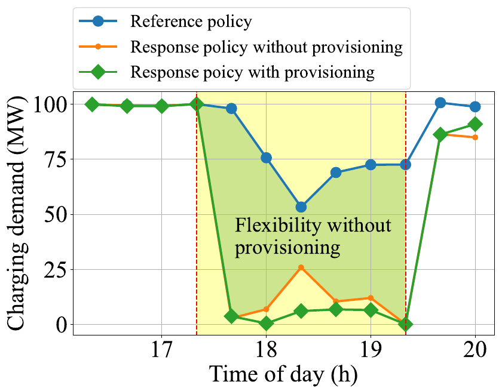</td><td>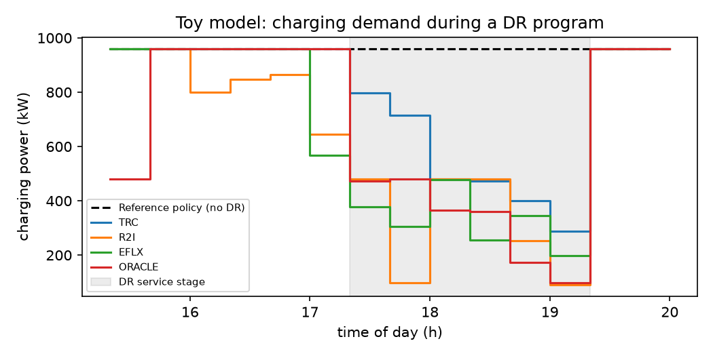</td></tr>
</table>

| Toy city, with charging limit | Flexibility | DR-window charging | Served |
|---|---|---|---|
| TRC | 870 kWh | 1050 kWh | 100% |
| R2I | 1256 kWh | 628 kWh | 100% |
| **eFlx** | **1267 kWh** | **653 kWh** | 100% |
| Oracle | 1270 kWh | 650 kWh | 100% |

eFlx cuts DR-window charging by 38% vs TRC at full service, close to the Oracle.

---

## 3. Reproduction of the paper's results

**Setup:** NYC TLC yellow-taxi trips, March 2024 (2.01 M weekday Manhattan trips), 12 regions clustered from 62 taxi zones, the paper's battery and timing parameters, DR window 17:20–19:20. At the paper's fleet size (13,000 taxis) **every policy cuts DR charging to 0 MWh**, so policies cannot be compared (see Section 6). The main reproduction therefore uses **3,200 taxis**, the largest fleet we found where DR charging can't be eliminated, over 3 weekdays ([`run_manhattan.py`](run_manhattan.py), [`make_figures.py`](make_figures.py)).

Every result figure and table in the paper's evaluation is reproduced below.

### Fig. 6: flexibility
<table>
<tr><th>Paper</th><th>Ours (3,200 taxis, mean ± sd over 3 weekdays)</th></tr>
<tr><td>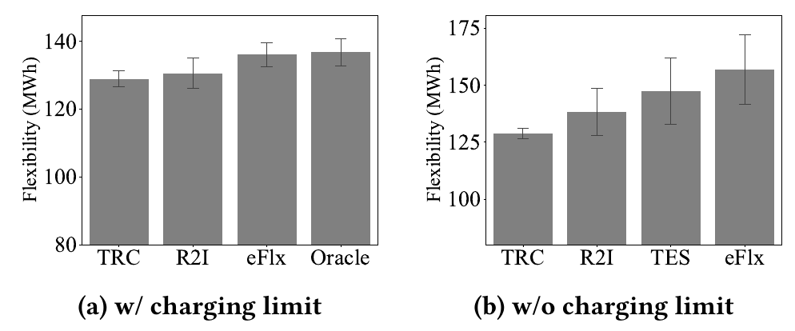</td><td>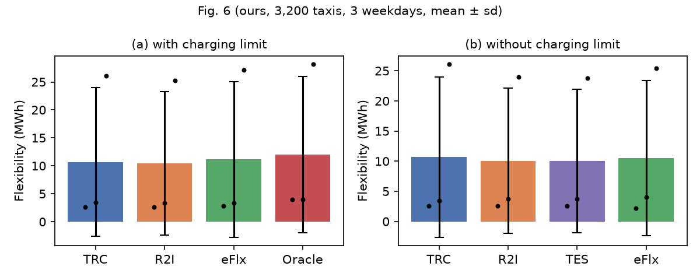</td></tr>
</table>

### Fig. 7: charging during the DR window
<table>
<tr><th>Paper</th><th>Ours</th></tr>
<tr><td>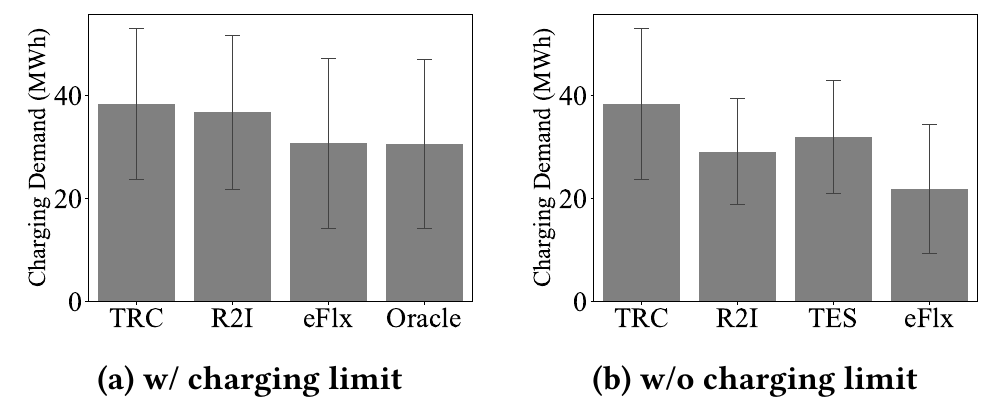</td><td>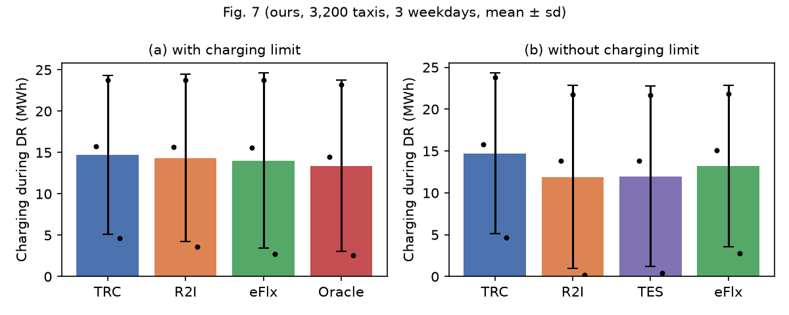</td></tr>
</table>

### Fig. 8: charging over one DR day
<table>
<tr><th>Paper</th><th>Ours (weekday 0)</th></tr>
<tr><td>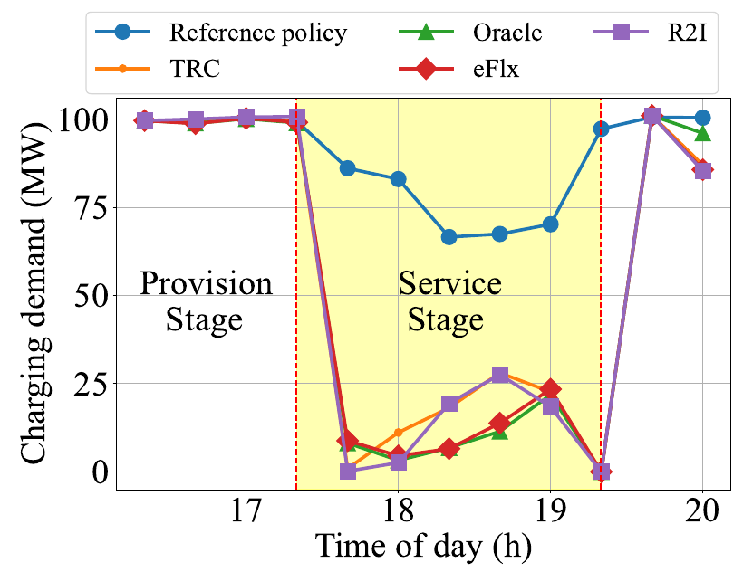</td><td>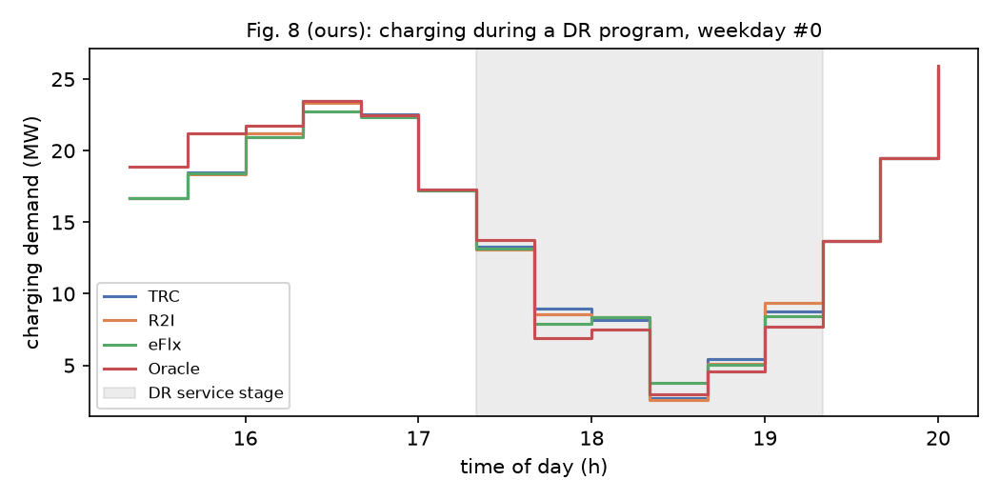</td></tr>
</table>

### Fig. 9: charging during the provision stage
<table>
<tr><th>Paper</th><th>Ours</th></tr>
<tr><td>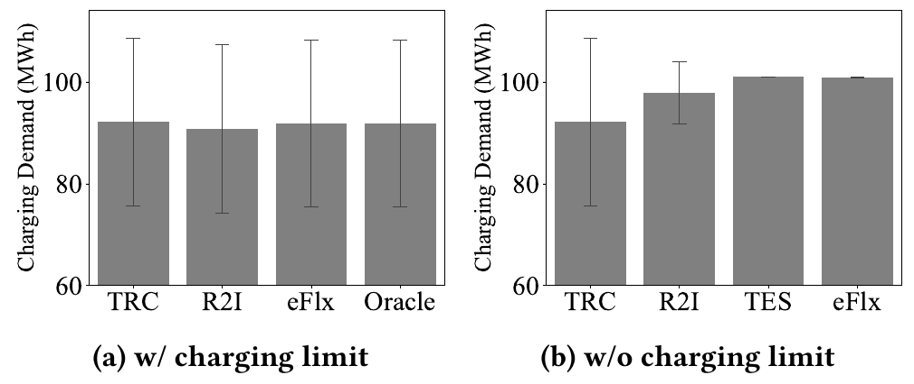</td><td>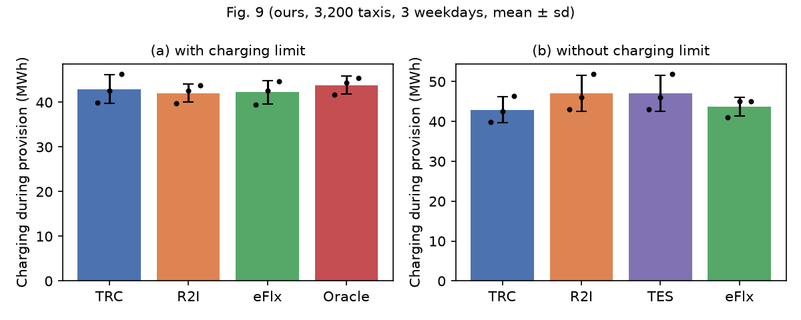</td></tr>
</table>

### Fig. 10: overhead (idle driving and waiting)
<table>
<tr><th>Paper</th><th>Ours</th></tr>
<tr><td>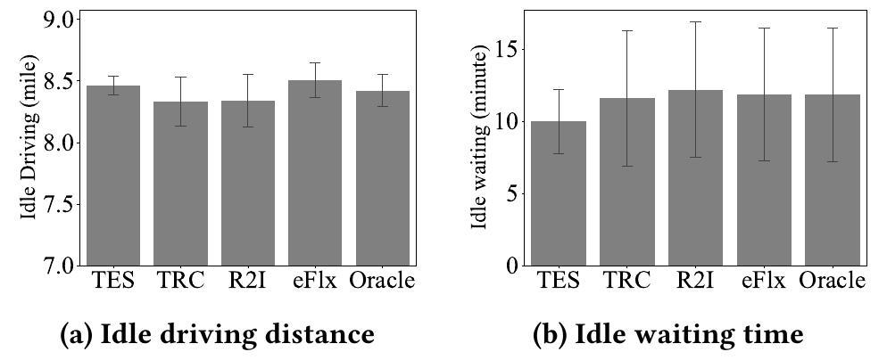</td><td>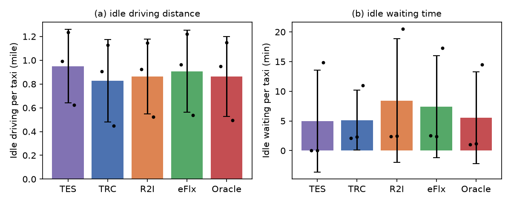</td></tr>
</table>

### Fig. 11: performance vs duration of the provision stage
The DR window stays fixed at 17:20; provisioning starts 20–120 minutes before it ([`paper_extras.py`](paper_extras.py)). The paper shows 20–60 minutes.

<table>
<tr><th>Paper</th><th>Ours, Manhattan (3,200 taxis, weekday 0)</th></tr>
<tr><td>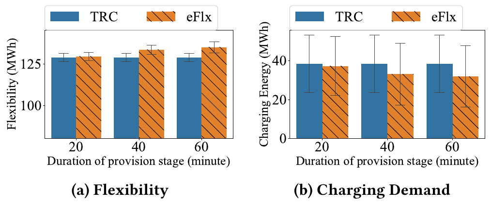</td><td>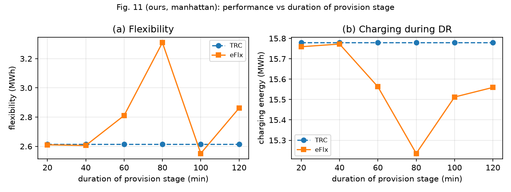</td></tr>
<tr><th></th><th>Ours, toy city</th></tr>
<tr><td></td><td>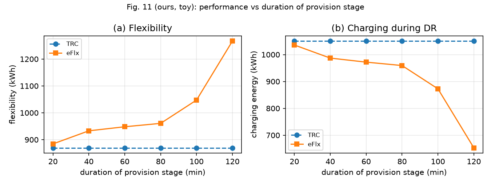</td></tr>
</table>

**Partly holds.** On the toy city the paper's trend reproduces cleanly: eFlx flexibility rises steadily from 884 to 1267 kWh as provisioning grows from 20 to 120 minutes, while TRC stays at 870 kWh. On Manhattan the trend is noisy: eFlx gains nothing over TRC with 20–40 minutes (2.61 MWh), peaks at 80 minutes (3.31 MWh), then falls back (2.55 MWh at 100, 2.86 MWh at 120 minutes). The paper shows only 20–60 minutes and one smooth trend; on real data the benefit of a longer lead time is not monotonic.

### Table 1: robustness to demand-prediction errors
The planner sees a noisy demand forecast with a mean absolute error of 10% (the paper's level; its noise model is not given, so we use multiplicative Gaussian noise per slot and region), while the fleet meets the true demand.

<table>
<tr><th>Paper</th></tr>
<tr><td>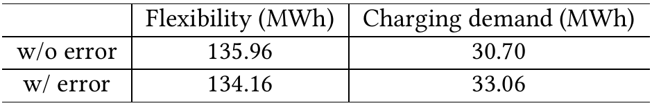</td></tr>
</table>

| eFlx, change under 10% forecast error | Flexibility | DR-window charging | Passengers served |
|---|---|---|---|
| Paper | −1.33% | +7.69% | not reported |
| Ours, toy city (10 noise seeds) | +3.6% | −7.0% | 95.4% |
| Ours, Manhattan (2 noise seeds) | **−6.8%** (2.86 → 2.67 MWh) | −3.4% | **93.9%** |

**Weaker than the paper claims.** On Manhattan, flexibility drops by 6.8%, five times the paper's 1.33%. With a wrong forecast, taxis are sent to the wrong places and about 5% of passengers are missed, which the paper does not report at all. (The toy's flexibility *rises* for the same reason: missed passengers mean less driving and less energy used.) Most importantly, under the same noise eFlx's advantage over TRC almost disappears on Manhattan: 2.67 vs 2.63 MWh of flexibility (TRC changes by +0.8%), whereas the paper states that eFlx "still outperforms TRC". Details: [`results/table1_manhattan.md`](results/table1_manhattan.md), [`results/table1_toy.md`](results/table1_toy.md).

### Claim by claim
Totals over 3 weekdays, 3,200 taxis ([`results/manhattan_3200_claims.md`](results/manhattan_3200_claims.md)):

| Claim (eFlx vs …) | Paper | Ours | Verdict |
|---|---|---|---|
| Flexibility vs TRC (with limit) | +5.52% | +3.95% | Partly holds |
| DR charging vs TRC (with limit) | −19.98% | −4.81% | Direction only |
| DR charging vs R2I (with limit) | −16.36% | −2.27% | Direction only |
| DR charging, gap to Oracle | +0.51% | +4.61% | Does not hold |
| DR charging vs R2I (no limit) | −24.73% | +11.05% | Reversed |
| DR charging vs TES (no limit) | −31.37% | +10.37% | Reversed |
| Provision charging vs TRC (no limit) | +9.45% | +1.89% | Same direction |
| Idle driving vs TRC | +2.06% | +9.66% | Higher overhead |
| Idle waiting vs TRC | +2.12% | +44.14% | Higher overhead |
| Runtime per provision slot | 254.7 s | 236 s | Matches |

**Summary.** The paper's qualitative story reproduces: provisioning adds flexibility and lowers DR-window charging at full service. The size of the gains does not: they are 2–4× smaller, come almost entirely from one of three days (−1.4%, 0%, −41% vs TRC), and reverse without the charging limit. Likely causes are the unpublished parameters, the fleet-size regime and LP tie-breaking (Section 6), not hardware or random seeds.

---

## 4. New ideas

### 4.1 P-eFlx: planning for when DR is likely

**Problem.** eFlx always prepares for DR in the *next* slot (τ = 1), which is pessimistic; the Oracle knows the exact start, which is unrealistic. Real DR events cluster around the evening peak.

**Idea.** P-eFlx takes a prior over DR start times and, at each slot, minimises the *expected* DR-window charging given DR has not started yet. Slot k of the horizon gets weight w_k = Σ_s P(start = s | start > t) · 1[s ≤ t+k < s + T_b]. Only the objective weights change; the LP has the same size as eFlx's. With a "next slot" prior it reduces exactly to eFlx (our sanity check). Code: `p_eflx` and `dr_weights` in [`eflx/policies.py`](eflx/policies.py), experiments in [`improvement.py`](improvement.py).

<table>
<tr><th>Toy city (true DR start varied)</th><th>Manhattan (3,200 taxis, DR at 16:40 / 17:20 / 18:00)</th></tr>
<tr><td>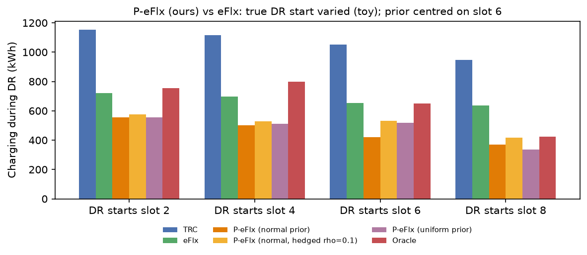</td><td>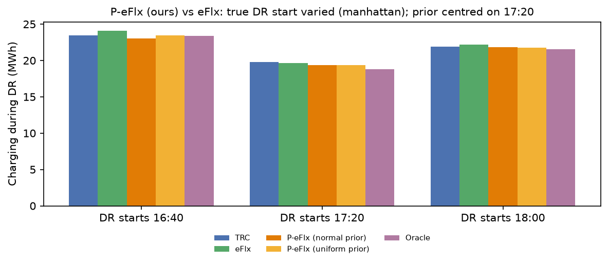</td></tr>
</table>

| Mean DR-window charging | Toy | Manhattan (total, 6 runs) |
|---|---|---|
| TRC | 1067 kWh | 130.3 MWh |
| eFlx | 677 kWh | 132.0 MWh |
| **P-eFlx (normal prior)** | **461 kWh (−32%)** | **128.5 MWh (−2.6%)** |
| P-eFlx (uniform prior) | 479 kWh | 129.3 MWh |
| Oracle | 656 kWh | 127.5 MWh |

P-eFlx beats eFlx at every true start time on the toy city, including starts where its prior is wrong, and on Manhattan it closes ~75% of the eFlx–Oracle gap without knowing the start time. Caveats: one Manhattan day shows no difference, and part of another day's gain coincides with ~1 percentage point lower service.

### 4.2 Pricing the service compromise
**Gap.** The paper says a fleet may accept "a controlled level of service compromise" during DR (Sec. 2.4) but never measures it. **Idea.** During the DR window only, the response must serve at least (1 − ε) of the passengers the reference policy would serve, for ε = 0–10% (`service_eps` in [`eflx/policies.py`](eflx/policies.py), experiments in [`new_ideas.py`](new_ideas.py)). Each policy provisions once; every ε starts from the same fleet state at the DR start, so at ε = 0 the results equal the main reproduction exactly (Manhattan: TRC 2.61, eFlx 2.86 MWh; toy: 870, 1267 kWh).

<table>
<tr><th>Toy city</th><th>Manhattan (3,200 taxis, weekday 0)</th></tr>
<tr><td>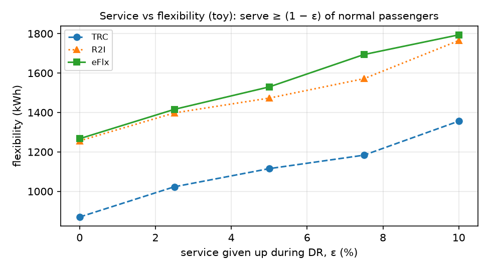</td><td>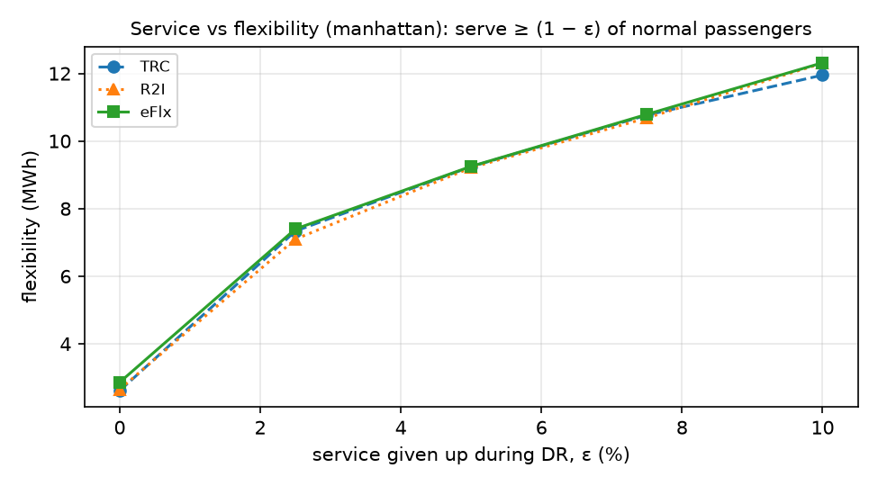</td></tr>
</table>

| Manhattan flexibility (MWh) | ε = 0 | 2.5% | 5% | 7.5% | 10% |
|---|---|---|---|---|---|
| TRC | 2.61 | 7.33 | 9.24 | 10.77 | 11.95 |
| R2I | 2.65 | 7.10 | 9.21 | 10.68 | 12.30 |
| eFlx | 2.86 | 7.40 | 9.25 | 10.79 | 12.32 |
| Passengers actually served in the window (eFlx) | 100% | 95.8% | 92.4% | 89.5% | 86.6% |

**Finding.** On Manhattan, missing about 4% of passengers during the two-hour window multiplies flexibility by 2.6 (eFlx 2.86 → 7.40 MWh), while eFlx's provisioning adds only 0.25 MWh over TRC, which is worth less than 1% of service. On the toy city, eFlx at full service (1267 kWh) matches TRC giving up about 9–10% of passengers (1356 kWh at ε = 10%). So for a tight fleet, a small, controlled service compromise is a much bigger lever than smarter provisioning, and these curves are what a grid operator and a taxi company would need to price a DR contract. (The measured service loss is slightly larger than ε because service is re-planned each slot and shortfalls compound.)

---

## 5. Extensions to the implementation

Beyond a faithful re-implementation, we extended the code so the method can be run at scale, tested and stressed:

| Extension | Why | Where |
|---|---|---|
| **Fast sparse LP builder** (same LPs, built directly as sparse matrices for HiGHS), ~20× faster, verified against the readable version | cvxpy is too slow for 12 regions × 15 levels × 10-slot horizons | [`eflx/fastplan.py`](eflx/fastplan.py), [`tests/test_fastplan.py`](tests/test_fastplan.py) |
| **Forecast vs truth in the simulator**: the planner can see a noisy demand forecast while the fleet meets the true demand | Needed for the robustness test (Table 1); the paper's simulator has no model mismatch | `true_demand` in [`eflx/sim.py`](eflx/sim.py) |
| **Variable provision length and DR start** | Fig. 11 and the DR-timing study | [`paper_extras.py`](paper_extras.py), [`improvement.py`](improvement.py) |
| **P-eFlx policy** (Section 4.1) | New idea | `p_eflx` in [`eflx/policies.py`](eflx/policies.py) |
| **Service relaxation and upward-charging response** (`service_eps`, `upward`) | New idea 4.2 and the surplus-power use case | `response` in [`eflx/policies.py`](eflx/policies.py), [`new_ideas.py`](new_ideas.py) |
| **Configurable Manhattan instance** (fleet size, ports, battery size) and a **parallel, resumable multi-day runner** | Fleet-size sweep and error bars across days | [`eflx/manhattan.py`](eflx/manhattan.py), [`run_manhattan.py`](run_manhattan.py) |
| **NYC data pipeline**: TLC trip records → regions, demand per slot, trip matrices | The paper's processed data is not public | [`scripts/get_nyc_data.py`](scripts/get_nyc_data.py) |

---

## 6. New use cases and examples

| Use case | What it shows |
|---|---|
| **Toy city** (2 regions, 100 taxis) | A case small enough to check by hand; reproduces the core idea (Section 2) |
| **Fleet-size sweep** | When eFlx can help at all (below) |
| **Absorbing surplus power** (upward flexibility) | See below: almost no room, because normal operation already uses every free charger |
| **Under-supplied vs moderately loaded toy fleet** | With a slightly short fleet (95% of trips served) every policy has ~0 flexibility; at 70% load flexibility appears. The paper's Fig. 3, with numbers |
| **DR at different times** (16:40, 17:20, 18:00) | The paper only tests 17:20; used to evaluate P-eFlx |
| **Several weekdays** | Day-to-day variation is large: the gain is −1.4%, 0% and −41% on three days |
| **Rebound after DR** | Charging jumps straight back after 19:20, creating a new peak (Fig. 8, right edge) |
| **LP tie-breaking** | Two builders with identical optima give closed-loop results up to 14% apart (toy Oracle: 650 vs 561 kWh), so small gaps like "0.52% from the Oracle" may be solver noise |

### Fleet-size sweep
Least possible DR-window charging at full service, from the 15:20 fleet state (open-loop check):

| Fleet | TRC DR charging | Best possible |
|---|---|---|
| 13,000 (paper) | — | 0 MWh |
| 8,000 | 100.6 MWh | 0 MWh |
| 6,000 | 66.2 MWh | 0 MWh |
| 5,000 | 59.0 MWh | 0 MWh |
| 4,000 | 35.0 MWh | 0 MWh |
| **3,200 (ours)** | 12.5 MWh | **6.6 MWh** |

Under the paper's model, a fleet of Manhattan's size sits in the "easy" corner of the paper's own Fig. 3: there are so many spare, charged taxis that any policy can stop charging during DR. The paper's nonzero results imply much tighter unpublished parameters, and it reports no sensitivity analysis.

### Absorbing surplus solar and wind power
The paper only studies cutting load. With high shares of solar and wind, grids also need the opposite: customers that use *more* power when there is a surplus. We reverse the response objective so the fleet **maximises** charging in the window, with the same service and idle-distance rules (`upward=True`).

<table>
<tr><th>Manhattan (3,200 taxis, weekday 0)</th></tr>
<tr><td>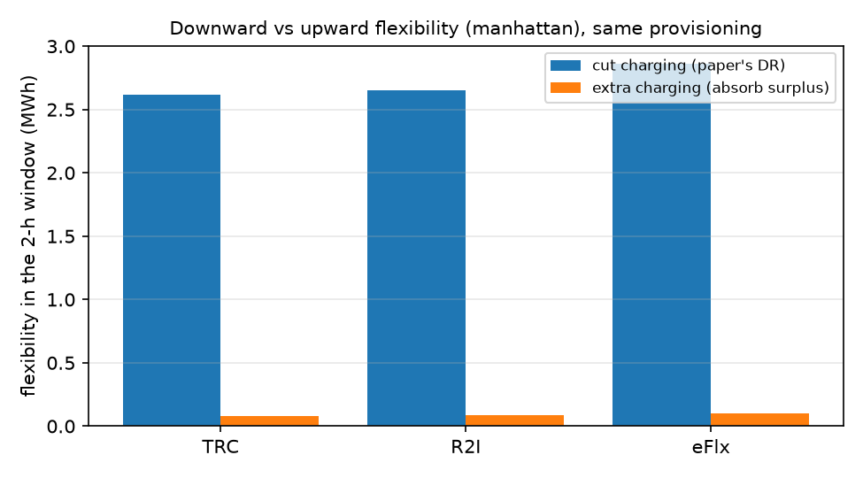</td></tr>
</table>

| Manhattan, 2-hour window | TRC | R2I | eFlx |
|---|---|---|---|
| Downward flexibility (cut) | 2.61 MWh | 2.65 MWh | 2.86 MWh |
| Upward flexibility (extra charging) | 0.08 MWh | 0.08 MWh | 0.10 MWh |

**Finding.** The fleet can absorb almost nothing extra: about 0.1 MWh, against 2.6–2.9 MWh of cut. Normal operation (TRC, as we implement it) already charges at every free port whenever a battery has room, so there is nothing left to switch on; on the toy city there is no room at all. A fleet that wants to sell both directions must deliberately hold some charging back in advance, a two-sided provisioning problem the paper does not consider.

---

## Conclusion
- **Holds:** provisioning increases fleet flexibility at full service; the direction of every with-limit claim; runtime.
- **Doesn't hold:** the size of the gains (−4.8% vs −19.98%), the 0.5% Oracle gap (ours 4.6%), and eFlx's advantage without the charging limit. At the paper's fleet size no policy can be distinguished.
- **Doesn't hold on real data either:** a smooth Fig. 11 trend, and robustness to forecast error: under 10% noise eFlx's flexibility drops 6.8% and its edge over TRC almost vanishes.
- **Added:** an open re-implementation, reproduction of every evaluation figure and table, multi-day error bars, fleet-size and DR-timing studies, and two new ideas: P-eFlx (−2.6% DR charging vs eFlx on Manhattan) and a measured service–flexibility trade-off (4% of passengers buys 2.6× the flexibility). A new use case, absorbing surplus power, shows a fleet has almost no upward flexibility unless it plans for it.
- **Limitations of our work:** parameters the paper omits had to be chosen; 12 regions instead of 38; a fluid (not per-taxi) simulator; few weekdays.

## Reproducing this report
```bash
.venv/bin/python tests/test_fastplan.py                       # validation
.venv/bin/python toy_demo.py                                  # Section 2
.venv/bin/python paper_extras.py --city toy                   # Fig. 11 / Table 1, toy
.venv/bin/python improvement.py --city toy                    # Section 4, toy
.venv/bin/python run_manhattan.py --fleet 3200 --days 0 8 16 --out results/manhattan_3200.json   # hours
.venv/bin/python make_figures.py manhattan_3200 3200          # Figs. 6-10
.venv/bin/python paper_extras.py --city manhattan --day 0 --workers 8                           # hours
.venv/bin/python new_ideas.py --city toy                      # Section 4.2 + surplus power, toy
.venv/bin/python new_ideas.py --city manhattan --day 0 --workers 8                              # ~35 min
```
